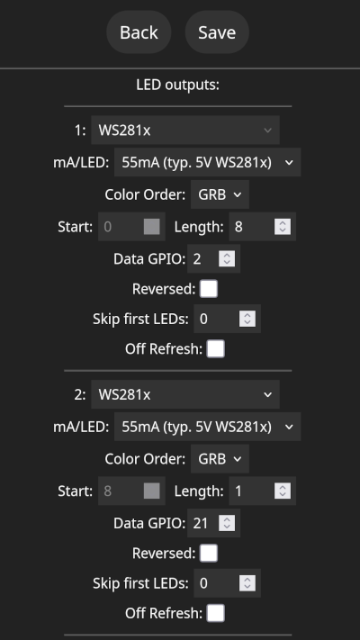

# WLED Firmware

<!--
SPDX-FileCopyrightText: 2025 Hackropole
SPDX-License-Identifier: CC-BY-4.0
-->

[WLED](https://kno.wled.ge/) is a opensource firmware to control WS2812 LEDs
with a nice Web interface and touch buttons.
WLED is free software under the European Union Public License 1.2.

## Flash firmware

To flash the firmware, you need to have `esptool` installed.
If your package distribution does not ship `esptool`, you may follow the official
instructions to install it via pip:
<https://docs.espressif.com/projects/esptool/en/release-v4/esp32/installation.html>

Connect the ESP32-S3 USB cable while pressing the boot button (marked "B") to
enter the bootloader mode.
Make sure you user can write to '/dev/ttyACM0'. Then:

```bash
esptool.py --port /dev/ttyACM0 erase_flash
esptool.py --port /dev/ttyACM0 write_flash 0x0 bootloader.bin
esptool.py --port /dev/ttyACM0 write_flash 0x8000 partitions.bin
esptool.py --port /dev/ttyACM0 write_flash 0x10000 firmware.bin
```

Then reset the board (e.g. by unplugging it).

## Initial Wi-Fi setup

After successfully flashing the firmware, you should see a new Wi-Fi network `WLED-AP`.
You may connect to this network using the following password: `wled1234`,
then you should see a web page "Welcome to WLED!".
You may press "WIFI SETTINGS" to configure the badge as a Wi-Fi client.

By default button 0 (rooster's crest) should toggle the light, and button 1
(1rst pillar) should cycle effects.

## Build firmware from sources

If you don't trust our pre-built binaries, you may download and rebuild them
from source!

```bash
git clone https://github.com/wled/WLED
# checkout v0.15.1, this matchs distributed pre-built binaries
git checkout v0.15.1
# copy `platformio_override.ini` to WLED repository
# this file adds a custom target with our default settings
cp ../hackropole-badge/firmware-wled/platformio_override.ini ./platformio_override.ini
# build!
pio run -e WLED_hackropole -t upload
```

The firmware is pre-configured: all LEDs should be yellow.
If not, double-check your soldering.

## Manual configuration

If you did not flash the pre-configured firmware, or want to understand how to
configure WLED to add some user-modding, you may follow these instructions.

The Hackropole badge has:

- 8 WS2812B LED on GPIO 2
- 1 WS2812B LED on GPIO 21 (built-in on ESP32S3 board)
- 8 capacitive touch buttons on GPIO 1, 3, 4, 5, 7, 8, 9, 10 (each pillar),
  and one on GPIO 6 (rooster's crest)
- GPIO 14 and 15 exposed on pads for user modding (e.g. for 3.3V I2C sensors,
  I2S microphone)

To configure the LED, you should go to `Config > LED Preferences`
(or `http://DEVICE_IP/settings/leds`), then in "Hardware setup / LED outputs" configure:

- The first output should be `Length: 8`, `Data GPIO: 2`
- The second output should be `Length: 1`, `Data GPIO: 21`



To configure the buttons, go to the same page (still in `LED Preferences`), and configure:

- Button 0 GPIO: 6 Touch (rooster's crest)
- Button 1 GPIO: 1 Touch (1rst pillar)
- Button 2 GPIO: 4 Touch (2nd pillar)
- Button 3 GPIO: 7 Touch (3rd pillar)
